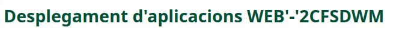

# Mi repositorio

## Descripción
Este repositorio contiene los ejercicios y prácticas realizados durante el curso de **Desarrollo de Aplicaciones Web (DAW)**.

### Contenido
En este repositorio podemos encontrar diferentes ejercicios relacionados con:
- HTML y CSS.
- JavaScript.
- PHP.
- Git y GitHub.

## Sobre el proyecto
Este proyecto tiene como objetivo aprender y mejorar mis conocimientos de *desarrollo web*.

Puedes consultar más información en [GitHub](https://github.com/).

## Imagen del proyecto


## Ejemplo de código
```javascript
function saludar() {
    console.log("Hola, mundo");
}

saludar();
```